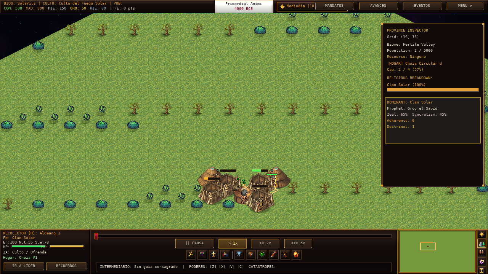

# Marangatu: The Faith Simulator

[]()
[]()
[]()
[]()

**Marangatu: The Faith Simulator** es un simulador de religiones y organismos vivos en perspectiva isométrica 2.5D, desarrollado nativamente en **C++20** con un motor de rasterización por software propio y presentación por hardware (X11 / Win32 / OpenGL).

*Marangatu* significa **sagrado / virtuoso** en guaraní. En este mundo procedural, la fe no es estática: es un ecosistema vivo que evoluciona, se adapta al territorio, interactúa con la biología y la psicología de los aldeanos, atraviesa cismas, engendra sincretismos híbridos y sobrevive a través de ocho eras históricas (desde el animismo primordial en el 4000 a.C. hasta el transhumanismo postbiológico).

---

## 📸 Instantáneas del Juego (Pre-Alpha v0.4.0)

| Ciclo Diurno y Vida Activa en la Aldea | Dominancia Territorial de Fes |
| :---: | :---: |
|  |  |

| Interacción Comunitaria de Aldeanos | Inspector de Unidad y Estadísticas Biológicas |
| :---: | :---: |
|  |  |

---

## 🌟 Novedades y Sistemas Clave de la Versión Pre-Alpha v0.4.0

### 1. Organismos Vivos y Ciclo Circadiano Integral
* **Ciclo Día / Noche (DayNightCycle):** Ciclo circadiano de 90 segundos con modulación atmosférica, color ambiental progresivo (Madrugada, Amanecer, Mediodía, Atardecer, Noche) y órbitas celestiales de Sol y Luna con posicionamiento cenital en el mapa mundial.
* **Sueño y Descanso Biológico:** Durante la noche, los aldeanos experimentan necesidad de descanso y buscan sus hogares o la fogata comunal (`m_isSleeping = true`, partículas flotantes `z Z`).
* **Despertar Matutino Sin Bloqueos:** Al romper el alba, los aldeanos despiertan de forma confiable, restauran su movilidad y se reincorporan a sus tareas productivas (recolección, culto, tala, cortejo).
* **Fatiga y Pausa Diurna:** El agotamiento diurno genera pausas breves de recuperación de estamina (`IDLE`, +8 energía/s) sin inducir comas de sueño profundo durante el mediodía.
* **Instinto Protector Familiar y Furia en Combate (+35% Daño):** Si un miembro de la familia (padre, madre o hijo) es atacado, los parientes despiertan instantáneamente con *Furia Protectora*, duplicando su agresividad y aumentando su poder de ataque un 35% para defender a su sangre.
* **Cortejo, Matrimonio y Reproducción Probabilística:** Los aldeanos solteros cortejan al sexo opuesto durante el día. Las parejas consolidadas en viviendas habitables engendran descendencia calculada por factores bio-espirituales (salud, reservas de comida, devoción y comodidad del hogar).
* **Apego Filial Nocturno:** Los infantes acompañan a sus padres y se acurrucan a su lado durante la noche.

### 2. Sistema de Viviendas y Construcción Tribal (BuildingSystem)
* **Tipos de Vivienda:** Choza de paja (*Thatched Hut*, cap. 4), cabaña de madera (*Wood Lodge*, cap. 6) y casa redonda de piedra (*Stone Roundhouse*, cap. 8).
* **Construcción Multifase:** Búsqueda autónoma de parcelas idóneas, acarreo de materiales (madera y piedra) y progreso constructivo secuencial.
* **Cobijo y Ocultación de Sprites:** Los aldeanos que descansan dentro de una vivienda terminada quedan protegidos bajo techo (su sprite se oculta para reflejar estancia interior).
* **Resplandor de Hogar y Chimenea:** Las viviendas habitadas emiten un brillo cálido dinámico y partículas de descanso sobre el tejado.

### 3. Físicas de Ragdoll y Poderes Divinos Cataclísmicos
* **Motor de Ragdoll Físico (RagdollSystem):** Simulación física en 3D de impulso, elevación, gravedad, velocidad angular, arrastre y desaceleración en suelo tras impactos y explosiones.
* **Poderes Divinos y Desastres:**
  * **Meteorito:** Descenso supersónico, cataclismo en zona de impacto, dispersión física en ragdoll y cráter permanente.
  * **Terremoto:** Fisuras tectónicas, temblor de pantalla y daño estructural a viviendas.
  * **Volcán:** Erupción de cono volcánico, ríos de magma, solidificación de lava en roca y expansión de costas.
  * **Tornado:** Vórtice que absorbe unidades del suelo, las eleva y las arroja en ragdoll.
  * **Incendio Forestal (*Wildfire*):** Propagación de fuego por vegetación y árboles según bioma y viento.
  * **Plaga y Enfermedad:** Contagio epidémico entre aldeanos no inmunes con tos y debilidad.
  * **Milagro Divino:** Incremento masivo de fe, conversión espontánea y bendición de cosechas.
  * **Relámpago Divino:** Rayo fulminante con destello celestial de domo y sonido espacial atronador.

### 4. Moralidad Religiosa y Motor Mitológico Sísifo
* **Doctrinas y Mandatos Morales:** 10 leyes religiosas configurables (ofrenda de diezmo sagrado, tregua sagrada de fronteras, hospitalidad nómada, templanza monástica, etc.).
* **Registro de Pecado y Penitencia:** Los actos justos generan fervor, mientras que transgresiones generan culpa que exige penitencia u oración en santuarios.
* **Némesis Sísifo:** Sistema de modulación cultural que genera mitos, profetas rivales, cismas orgánicos y dinámicas de tensión territorial.

### 5. Guardián de Rendimiento y Anti-Lag (ErrorSystem)
* **Auditoría de Fotogramas en Tiempo Real:** Filtro de media móvil exponencial para calcular el tiempo de cuadro y activar mitigaciones anti-lag preventivas si cae de 30 FPS.
* **Control de Desbordamiento:** Prevención de escrituras fuera de búfer y límites de población dinámicos para garantizar estabilidad sin caídas de rendimiento.

---

## 🎮 Controles y Navegación

| Acción | Control |
|---|---|
| **Seleccionar provincia / unidad / UI** | Clic izquierdo |
| **Panorámica de cámara** | Clic derecho + arrastre, `W A S D` o flechas |
| **Zoom de cámara** | Rueda del ratón o teclas `+` / `-` |
| **Centrar cámara en el origen** | Tecla `R` |
| **Pausar / Reanudar simulación** | Barra espaciadora (`Espacio`) |
| **Velocidad de simulación** | Botones de HUD: `> 1x`, `>> 2x`, `>>> 5x` |
| **Desplazamiento histórico (Scrubbing)** | Arrastrar la barra inferior de la línea de tiempo |
| **Ir a epicentro de evento** | Clic en una tarjeta de la crónica histórica |
| **Consola de trucos y comandos** | Tecla `Enter` en partida |
| **Volver al menú / Salir** | Tecla `Esc` |

### Comandos de Consola (`Enter` en partida):
* `LUMINUS`: Disipa o restaura la niebla de la fe en todo el mapa mundial.
* `DIA` / `DAY` / `MEDIODIA`: Fija el ciclo diurno a las 12:00 (plena iluminación cenital).
* `NOCHE` / `NIGHT`: Fija el ciclo diurno a las 23:00 (noche profunda e iluminación lunar).
* `AMANECER` / `DAWN`: Fija la hora a las 06:30 (aurora dorada).
* `ATARDECER` / `DUSK`: Fija la hora a las 18:30 (crepúsculo crepitante).
* `METEORO` / `VOLCAN` / `TERREMOTO` / `TORNADO`: Activa el modo de apuntado para lanzar catástrofes.

---

## 🏛️ Las Ocho Eras Históricas

1. **Primordial Animism (-4000 a -3000):** Bandas nómadas de cazadores-recolectores. Espiritualidad ligada a ríos, piedras y fuego sagrado. Choza comunal básica.
2. **Totemism & Ancestor Worship (-3000 a -1800):** Tótems tribales, clanes de sangre, culto funerario. Amenaza: guerras territoriales inter-clánicas.
3. **Structural Shamanism (-1800 a -800):** Agricultura organizada, chozas circulares, chamanes ceremoniales y ofrendas de cosecha.
4. **Territorial Polytheism (-800 a 400):** Templos monumentales, panteones politeístas, guerras de conquista sagrada.
5. **Universal Religions (400 a 1500):** Doctrinas escritas, cruzadas, monjes misioneros y grandes herejías.
6. **Rationalization & Secularization (1500 a 1950):** Ilustración científica, división estado-fe, retroceso del dogmatismo tradicional.
7. **Post-Secular Age (1950 a 2050):** Redes globales, microcultos virales, espiritualidad individualizada y polarización.
8. **Transhumanist Post-Biological (2050 a 2200+):** Inmortalidad computacional, deificación de la inteligencia artificial y trascendencia.

---

## 🛠️ Compilación y Ejecución

El código fuente utiliza **C++20** estándar y soporta compilación nativa en **Linux** y **Windows**.

### En Linux (Nativo X11 / OpenGL)
Requiere `g++` (o `clang++`) compatible con C++20, `make`, `libx11-dev` y `libgl1-mesa-dev`:
```bash
# 1. Compilar suite de pruebas unitarias y verificar los 44 tests:
make test

# 2. Compilar el juego completo:
make all

# 3. Ejecutar en modo gráfico interactivo:
DISPLAY=:0 ./bin/religion_sim

# 4. Ejecutar en modo Headless (sin ventana, exportando captura):
./bin/religion_sim --headless --ticks 300 --export snapshot_sim.ppm
```

### En Windows (Nativo Win32 / OpenGL)
#### Con CMake (Visual Studio / CLion / MinGW):
```powershell
cmake -B build
cmake --build build --config Release
.\build\Release\religion_sim.exe
```

#### Con Make (MinGW-w64 en MSYS2 o Git Bash):
```bash
make all
./bin/religion_sim.exe
```

---

## 📁 Arquitectura del Proyecto

```
religion_simulator_isometric/
├── assets/                     # Spritesheets, tilesets, texturas de terreno, interfaz y audio
│   ├── sprites/                # Edificios, terreno, vegetación, chamanes, aldeanos y recursos
│   └── ui/                     # Botones litúrgicos, atlas de interfaz e iconos ceremoniales
├── include/                    # Cabeceras modulares C++20
│   ├── BuildingSystem.hpp      # Construcción, censo de hogares y cobijo bajo techo
│   ├── DayNightCycle.hpp       # Ciclo circadiano, posiciones sol/luna e iluminación
│   ├── DivinePowersSystem.hpp  # Cataclismos, meteoritos, volcanes y milagros
│   ├── ErrorSystem.hpp         # Auditoría de rendimiento, mitigación de lag y memoria
│   ├── Humano.hpp              # Entidad humana, roles, familia, furia y máquina de estados
│   ├── IsometricCamera.hpp     # Proyección diamante isométrica y transformación de coordenadas
│   ├── RagdollSystem.hpp       # Motor de físicas de impulso y ragdoll en 3D
│   ├── ReligiousMoralitySystem.hpp # Ética, doctrinas, culpa, penitencia y diezmo
│   ├── Renderer.hpp            # Rasterizador por software y capas de presentación
│   ├── Types.hpp               # Enumeraciones fuertemente tipadas en C++20
│   └── WorldMap.hpp            # Malla hexagonal/diamante, celdas y biomas Multi-Noise
├── src/                        # Implementaciones C++20 correspondientes
├── tests/                      # Suite de pruebas unitarias exhaustivas (44 tests)
│   └── test_simulation.cpp     # Verificación de todos los subsistemas del juego
├── Makefile                    # Configuración de compilación multihilo optimizada (-O3)
├── CMakeLists.txt              # Configuración CMake multiplataforma
└── README.md                   # Documentación oficial del proyecto
```

---

## 📜 Convenciones y Estándares de Código

El proyecto se rige estrictamente por la guía [GEMINI.md](file:///home/Ivancho/Documentos/GEMINI.md):
1. **Nombres de variables siempre en inglés:** Todos los nombres de variables locales, miembros, parámetros, métodos y constantes deben ser concisos, descriptivos y en inglés (sin nombres crípticos de una sola letra).
2. **Comentarios bilingües sistemáticos:** Todos los comentarios de bloque y de lógica deben estar redactados tanto en inglés como en español (`// EN: ... / ES: ...`).
3. **C++20 moderno:** Uso prioritario de `constexpr`, `enum class`, `<algorithm>`, RAII y const-correctness.

---

## 📄 Licencia y Estado del Proyecto

* **Estado:** Pre-Alpha v0.4.0 (Desarrollo Activo).
* **Repositorio Oficial:** [ivanbordon99/religion_simulator_isometric](https://github.com/ivanbordon99/religion_simulator_isometric)
* **Desarrollador:** Iván Bordón (`@ivanbordon99`).
